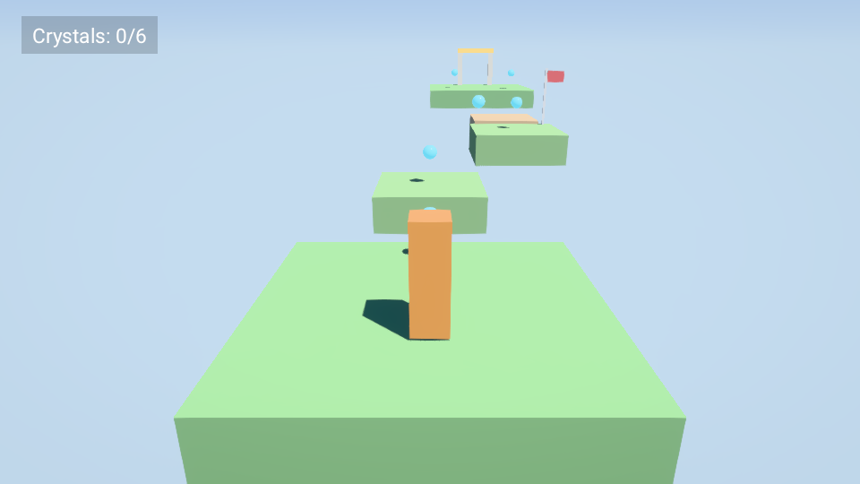
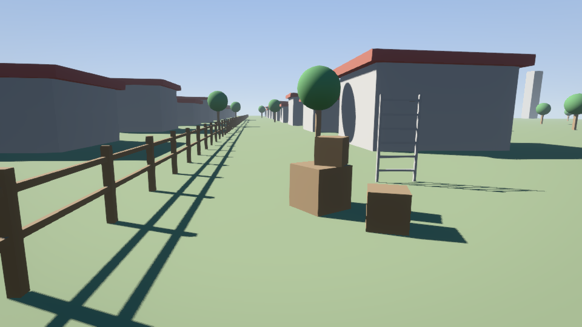
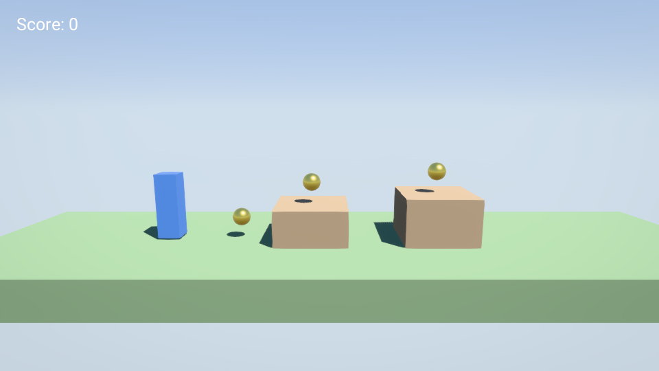
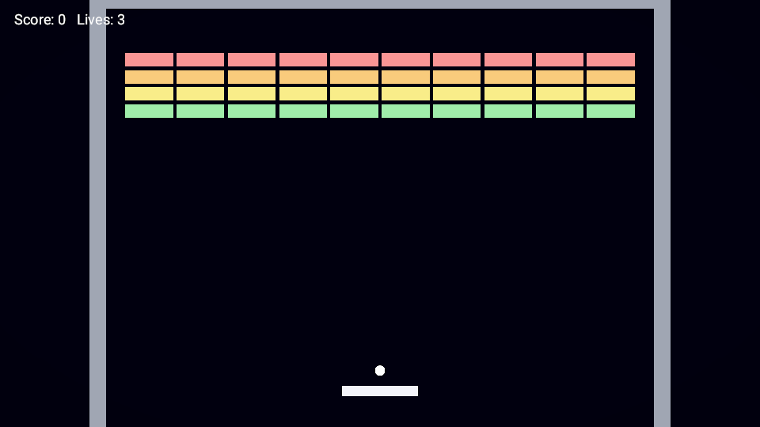
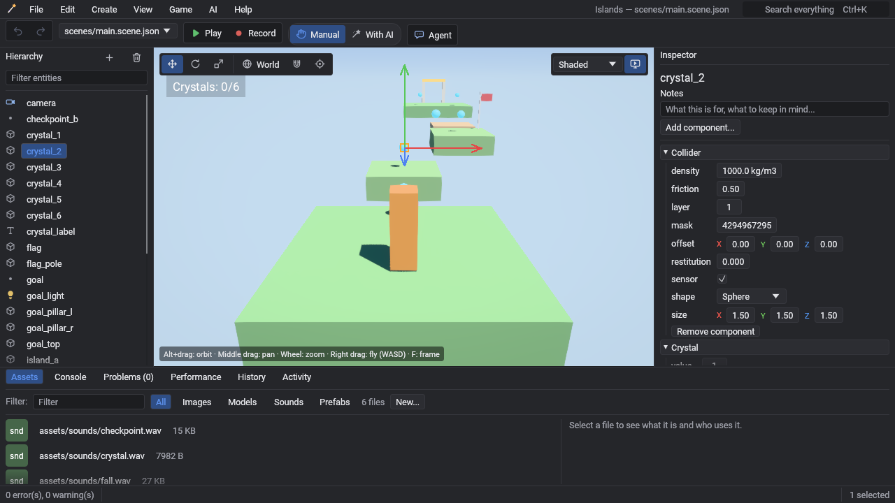
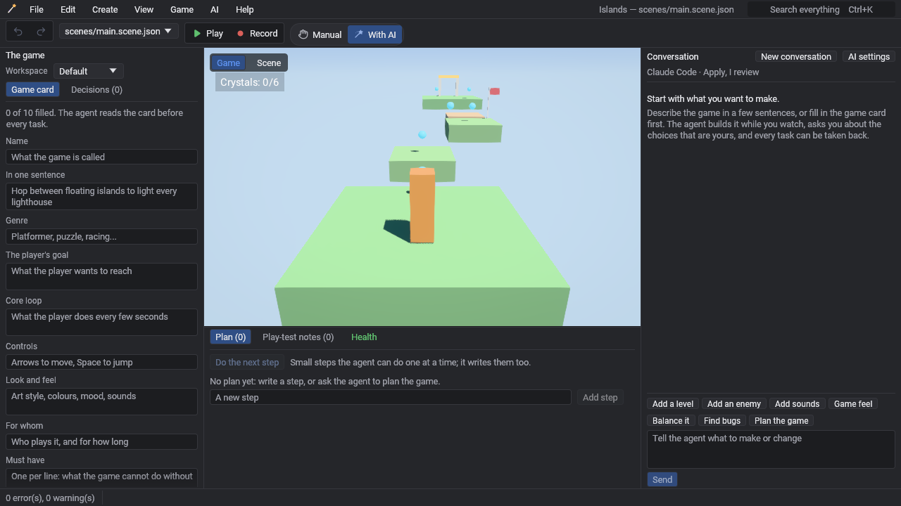

# Wish Engine

*Dile, olsun.* (Turkish for "Make a wish, and it is done.")

A free, open-source 3D game engine written in Rust, with no fee and no commission on the games made
with it. It is fully integrated with AI and fully usable without it: everything can be done by hand
in the editor, and an AI agent can drive the same engine through MCP. Both kinds of change land in
one history, signed with who made them.



*Islands, the showcase game in [examples/islands](examples/islands), from its own camera.*

## Status: not released yet

The code is at version 0.1.0 on the way to **1.0**. No release has been published, so there is
nothing to download yet: build it from source (below). Releases will be published on the
repository's [Releases page](https://github.com/akeremkar-sketch/wish-engine/releases), each with its archives for Windows and Linux
and a `SHA256SUMS` file. Versions are three numbers; the betas and
release candidates of 1.0 will be `0.x.0` tags.

**What 1.0 is:** an engine in which one person, an AI agent, or both together can make a small or
medium desktop 3D game and prove that it works, with a default look signed off by eye. It is
packaged and tested on **Windows and Linux** (x86-64): each system makes its own release archive and
exports games for itself.

**What 1.0 is not yet:**
- no macOS, web, mobile or console builds, and no export from one system to another (a game made
  on Windows is exported for Windows);
- 2D is a subset: an orthographic camera, sprites, particles and the in-game interface; tilemaps,
  sprite sheets and 2D physics come later;
- the tool surface and the game-code SDK are not frozen yet (see [stability](docs/STABILITY.md)).

What comes after 1.0, release by release: [docs/design/road-to-2-0.md](docs/design/road-to-2-0.md).

## Pictures

Every picture on this page was drawn by the engine itself, on the software adapter, under the
default look (*Natural*). `python tools/readme_pictures.py` draws them all again from a checkout.

| | |
|---|---|
|  |  |
| A level 400 m wide, built with one `edit_apply` call on a new project: cascaded shadows, sky light, fog, bloom, colour grading, FXAA. | [examples/hop](examples/hop): 3D jumping. |
|  |  |
| [examples/bricks](examples/bricks): 2D, with an orthographic camera. | The editor by hand: a menu bar and toolbar, the hierarchy with its filter, the scene view with its floating tools and a gizmo, the inspector, the assets. |



*The editor's AI mode at the start of a project: the game card (not filled in yet), the live game,
and the empty plan and conversation panels, with the ready requests for the agent.*

## What it does

- **Editor:**
  - Hierarchy, inspector, scene gizmos, asset browser, prefabs, material files.
  - Play / pause / step, and a timeline.
  - Replays and scenario tests.
  - 12 interface languages.
- **AI cockpit:**
  - Show and tell; a live activity feed.
  - Each change can be undone on its own, as long as the value it set is still there.
  - A checkpoint before every task.
  - Permission modes: only suggest / apply, I review / autonomous.
  - Any MCP client can connect, over standard input and output or over HTTP with a token.
- **Rendering:**
  - Physically based materials; glTF models with skeletal animation; material files with
    textures on primitives.
  - Cascaded shadows; point and spot lights (clustered forward+).
  - Sky light with a sun disc, fog, HDR bloom, colour grading, FXAA; see-through surfaces.
  - Three looks to start from (*Plain*, *Natural*, *Vivid*), each setting editable by hand.
- **Game systems:** physics (Rapier) and character movement, audio, input, the in-game interface,
  particles, 2D sprites.
- **Game code:** Rust, built to WebAssembly and run in a sandbox.
  - Hot reload without stopping the game.
  - The compiler ships in the release archive (see [what it needs](#what-a-release-archive-needs)).
- **Determinism:** the same build, scene, seed and inputs give a bit-for-bit identical world.
  Tests and replays rely on this.
- **Export:** a game folder with its own player, which needs neither the engine, the editor nor a
  compiler.

## How the claims above are checked

Every number and "works" on this page has a command that reproduces it, or says who checked it, on
what and when ([ADR-027](docs/DECISIONS.md#adr-027--four-rules-before-the-freeze-defaults-answers-versions-claims),
rule 4). The `cargo test` commands are free and run in CI on Windows and Linux.

| Claim | Command | Recorded result |
|---|---|---|
| Same build, scene, seed and inputs: the same world, bit for bit; the recorded world and physics hashes hold on Windows and Linux | `cargo test -p wish_ecs --test snapshot`, `cargo test -p wish_physics --test proof` | the recorded values in those tests |
| A 10,000-tick replay plays back bit for bit; the five example games are won by their tests and replayed | `cargo test -p wish_control --test script_tools` | the tests themselves |
| An exported game plays as the project does (the same world hash, in a separate process) | `cargo test -p wish_player --test export` | the test itself |
| The release archive works from the extracted copy alone: version, new project, build, test, export, a headless play of the exported game | the release workflow, [.github/workflows/release.yml](.github/workflows/release.yml), on GitHub's Windows and Linux runners | its dry run on 18 November 2026 (run 44371286033, commit 9002a3f): both archives passed |
| 34 control-plane tools, each with a way to do it by hand in the editor | `wen call` with an unknown tool name lists them; `cargo test -p wish_editor --test parity` | [docs/MCP_API.md](docs/MCP_API.md) |
| MCP protocol 2025-06-18 (2025-03-26 and 2024-11-05 are accepted) | `cargo test -p wish_mcp` | the MCP Inspector 2.13.0 check of 16 November 2026, 11/11 (25 tools then): [evals/results/m7-mcp-inspector.md](evals/results/m7-mcp-inspector.md); `python tools/mcp_inspector_check.py` |
| 12 interface languages | `wen edit --lang xx` names them in its error | [crates/wish_editor/lang](crates/wish_editor/lang) (11 translations and English) |
| The agent evaluation: **41 of 41 tasks** passed by Claude Code with Sonnet 5.5 · medium, one try each, on 16 November 2026 (the engine of commit ef23aac, the end of M7, before the rendering work of M12) | `wish-evals run --tries 1 --model sonnet --effort medium` (**spends model quota**); `wish-evals selftest` checks the tasks for free | [evals/results/m7-sonnet-5-5-medium.json](evals/results/m7-sonnet-5-5-medium.json); [evals/README.md](evals/README.md) |
| Eight scene tasks in the same words, Claude Code with Sonnet 5.5 · medium, on 18 November 2026, before the render work of M12: Unity 6.3 passed 7/8 for 0.80 $ and 6.8 tool calls a task; Wish Engine passed 8/8 for 0.70 $ and 5.0, and, measured again after the first round of AI efficiency work (recorded with commit 2881adb; Unity was not run again), 8/8 for 0.53 $ and 3.4. One run each; two runs of the same Wish build differed by 10% in cost. The tasks were written by the Wish Engine side | `python tools/compare/run.py run --engine wish --model sonnet --effort medium` (**spends model quota**; the Unity leg needs a Unity install: [tools/compare/README.md](tools/compare/README.md)) | [evals/results/compare-2026-11-18.md](evals/results/compare-2026-11-18.md), section "After the efficiency work" |
| The default look, *Natural* | chosen by eye by the project's owner on 19 November 2026, from pictures of nine scenes | [docs/design/M12-look-lock.md](docs/design/M12-look-lock.md) |
| Sound on Windows | heard by the project's owner on 21 November 2026, playing the showcase exported from the Windows release archive (after its hissing placeholder wind was removed) | [docs/design/M12-beta-self-test.md](docs/design/M12-beta-self-test.md) |

Not checked yet: the release archives on a computer that has never had a developer tool installed
(see below), sound by ear on Linux, and the editor in the hands of people who have not seen it
before (a test with three people is planned).

## Getting started

### Build from source

You need Rust 1.100.0 (pinned by `rust-toolchain.toml`; `rustup` installs it) with the
`wasm32-unknown-unknown` target. On Windows you also need Visual Studio Build Tools with the C++
workload; on Linux, the ALSA headers and `pkg-config` (`libasound2-dev pkg-config` on Debian and
Ubuntu).

```bash
cargo build --release -p wish_cli -p wish_player
```

The programs are in cargo's `target/release` folder. Once, build the game SDK next to `wen`, so
that it can build game code:

```bash
wen sdk
```

Then `wen edit` opens the welcome screen:
1. choose a helper (Claude Code, or nobody: by hand);
2. choose a template;
3. give a name and create.

Details: the [user guide](docs/user/en/guide.md). A Turkish guide is in
[docs/user/tr/guide.md](docs/user/tr/guide.md).

### A release archive

`wen package --out <folder>` makes the archive a release will be: `wen`, the player, the launcher,
the game SDK and the packed compiler, with every licence text and `SHA256SUMS`
(`.zip` on Windows, `.tar.gz` on Linux). How the release workflow builds and checks it:
[CONTRIBUTING.md](CONTRIBUTING.md#releases).

### What a release archive needs

- **Windows:** nothing for the engine, the editor or an exported game. Building game code
  currently also needs the Visual C++ runtime (`VCRUNTIME140.dll`), which most Windows computers
  have; a fix is open ([docs/design/M12-release-pipeline.md](docs/design/M12-release-pipeline.md),
  section 6).
- **Linux:** glibc 2.35 or newer (Ubuntu 22.04, Debian 12), the ALSA library (`libasound2`), a
  Vulkan driver or OpenGL, and the usual X11 or Wayland libraries of a desktop. The list is read
  from the libraries' features. The release workflow builds the Linux archive on Ubuntu 22.04,
  fails if any of its programs asks for a newer glibc, and runs it from the extracted copy on a
  full GitHub runner image: that proves it needs no developer tools, not that a bare system has
  every library it loads.

## Stability

Nothing is frozen before 1.0.0. From 1.0.0 on, file formats change only by addition or with a
migration, simulation results change only in a minor version, and old scene files keep opening:
[docs/STABILITY.md](docs/STABILITY.md).

## Documents

| Document | Contents |
|---|---|
| [docs/user/en/guide.md](docs/user/en/guide.md) | User guide (English) |
| [docs/user/tr/guide.md](docs/user/tr/guide.md) | User guide (Turkish) |
| [docs/STABILITY.md](docs/STABILITY.md) | What stays stable from 1.0.0, and what does not yet |
| [CONTRIBUTING.md](CONTRIBUTING.md) | Contributing guide: invariants, rules, verification |
| [docs/VISION.md](docs/VISION.md) | What we are making, and why |
| [docs/ARCHITECTURE.md](docs/ARCHITECTURE.md) | Layers and crates |
| [docs/DECISIONS.md](docs/DECISIONS.md) | Architecture decisions |
| [docs/MCP_API.md](docs/MCP_API.md) | The AI interface |
| [docs/ROADMAP.md](docs/ROADMAP.md) | Milestones |

## License

MIT or Apache-2.0, whichever suits you. Third-party licenses:
[THIRD_PARTY_LICENSES.md](THIRD_PARTY_LICENSES.md).
